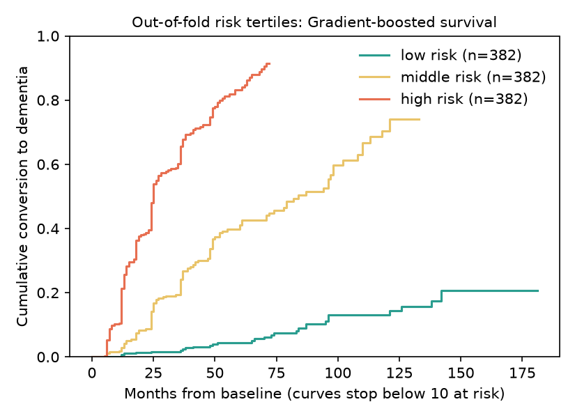
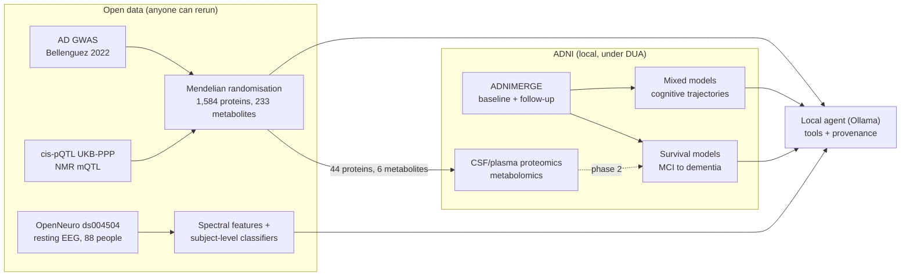

# dementia-multimodal-ml

[](https://github.com/mdegiulio97/dementia-multimodal-ml/actions/workflows/ci.yml)


**Who among people with mild cognitive impairment (MCI) progresses to dementia, and when?**

This repository answers that question with survival models and mixed-effects models on ADNI. It
then asks which circulating molecules might be causally involved, using Mendelian randomisation
on open genetic summary statistics. Separately, it tests whether resting-state EEG separates
Alzheimer's disease, frontotemporal dementia and healthy ageing. A local LLM agent sits on top:
it answers questions by calling the trained models and stored results, and it withholds any
answer containing a number that no tool returned.

Everything runs on a laptop CPU. Tests and CI run on a synthetic cohort with ADNI's structure,
so no access-controlled data is needed to try the code.



*Main figure: ADNI, 1,146 participants with MCI. Cumulative conversion to dementia by tertile
of out-of-fold predicted risk (gradient-boosted survival); curves stop where fewer than 10
people remain at risk.*

## How the parts fit together



The EEG cohort holds different people from ADNI, so EEG is a separate analysis and does not
enter the multimodal model.

## Quickstart

```bash
uv sync                                              # Python 3.12 environment from uv.lock
uv run python pipelines/conversion.py --data synthetic
uv run dementia-agent "What is the 3-year risk for a 74-year-old with MCI, MMSE 27 and one APOE4 allele?"
```

The agent needs [Ollama](https://ollama.com) with a tool-calling model
(`ollama pull qwen2.5:7b-instruct`). The analyses on real data:

```bash
uv run python pipelines/trajectories.py --data synthetic   # or --data adni
uv run python pipelines/mr_candidates.py                   # downloads ~1.2 GB of summary statistics
aws s3 sync --no-sign-request s3://openneuro.org/ds004504 "$DEMENTIA_ML_DATA/eeg/ds004504"
uv run python pipelines/eeg.py
uv run python pipelines/mr_candidates.py --outcome kunkle  # sensitivity outcome (no UK Biobank)
uv run --extra dl python pipelines/eeg_eegnet.py          # EEGNet on CPU (about 1 hour)
uv run python pipelines/coloc_candidates.py               # needs a Synapse token with UKB-PPP access
uv run python pipelines/coloc_susie.py                    # + UK Biobank LD matrices (public S3)
uv run python pipelines/prepare_adni.py --raw <unpacked ADNIMERGE2 download>   # local ADNI table
uv run python pipelines/conversion.py --data adni
uv run python pipelines/omics_adni.py --raw <unpacked ADNI download>           # MR candidates in ADNI
uv run python pipelines/fusion_adni.py --raw <unpacked ADNI download>          # multimodal fusion
uv run --extra mcp dementia-mcp                            # same tools over MCP (synthetic/open)
```

Data live outside the repository in `$DEMENTIA_ML_DATA` (default `~/data/dementia-ml`). Sources,
licences and checksums are listed in [docs/DATA_SOURCES.md](docs/DATA_SOURCES.md).

## ADNI results

| Analysis | Data | Result (95% CI) |
|---|---|---|
| MCI-to-dementia conversion, full model | ADNI, 1,146 MCI, 420 conversions | C-index 0.83 (0.81-0.85); td-AUC at 36 months 0.89 |
| Same, clinical baseline (age, MMSE, APOE4) | same | C-index 0.69 (0.67-0.72) |
| Faster decline in converters | same | MMSE 1.27/yr, ADAS13 2.85/yr, CDR-SB 1.07/yr |
| Multimodal fusion (clinical + regional MRI + CSF + proteomics + metabolomics) | same, missing modalities kept | C-index 0.83-0.84; +0.02 (CI excludes 0) over clinical scales alone |
| Biomarkers without functional scales | same | C-index 0.79 vs 0.69 baseline |
| MR candidates vs conversion, CSF proteomics | ADNI, 389 MCI (170 conversions), SomaScan 7k | not enriched (4/48 at p<0.05; same direction 19/48); ACE HR 0.76/SD, p=0.0006, same direction as MR |
| MR candidates vs conversion, NMR metabolomics | ADNI, 786 MCI (342 conversions) | not enriched (0/6 at p<0.05); no metabolite at FDR<0.05 |

## Results so far

| Analysis | Data | Result (95% CI) |
|---|---|---|
| EEG, AD vs controls | ds004504, 65 participants | AUC 0.91 (0.82-0.97), balanced accuracy 0.81 |
| EEG, FTD vs controls | ds004504, 52 participants | AUC 0.83 (0.70-0.94), balanced accuracy 0.73 |
| EEG, AD vs FTD | ds004504, 59 participants | near chance (AUC 0.53-0.61) |
| MR, proteins on AD | UKB-PPP + Bellenguez 2022 | 44 of 1,584 proteins at FDR < 0.05 (CR1, TREM2, CD2AP, GRN, EPHA1, ACE, CD33, ...) |
| MR, metabolites on AD | Karjalainen 2024 + Bellenguez 2022 | 7 of 233 at FDR < 0.05, mostly LDL/VLDL lipid composition; 6 pass the pleiotropy check |
| MR, independent outcome | Kunkle 2019 (no UK Biobank) | 42 of 45 testable candidates keep their sign |
| Colocalisation (coloc ABF) | UKB-PPP regional + Bellenguez 2022 | 7 of 9 strongest candidates share the causal variant with AD (CR1, PILRA/B, IL34, C1S/C1R, CD33; PP.H4 > 0.93) |
| Colocalisation (SuSiE, multiple signals) | + UK Biobank LD | ACE colocalises (PP.H4 0.98) through one of its five signals, giving a corrected MR estimate of −0.19 (−0.24 to −0.14); EPHA1 does not (0.008) |
| EEG, EEGNet vs spectral | ds004504 | EEGNet AUC 0.81 (AD vs CN), 0.64 (FTD vs CN): below spectral features with ~60 people |
| Conversion, method check | synthetic, 787 MCI | full Cox C-index 0.72 (0.68-0.76) vs baseline 0.64 (0.60-0.68) |

Details, comparisons with published results and limitations are in
[docs/RESULTS.md](docs/RESULTS.md); every figure is explained in [docs/FIGURES.md](docs/FIGURES.md).

## What makes the numbers trustworthy

- **No leakage.** Every split is by participant, so the epochs or visits of one person never sit
  on both sides. Models of conversion see baseline values only. Imputation and scaling are fitted
  inside each training fold. Tests check all three.
- **Honest baselines.** Every conversion model is compared with age + MMSE + APOE4.
- **Uncertainty everywhere.** Participant-level bootstrap intervals, calibration curves, FDR for
  the MR screen.
- **Known answers.** The synthetic cohort is generated from a known hazard and the tests check
  the Cox model recovers it. The MR estimators recover simulated causal effects, and Egger
  detects simulated pleiotropy. CD33, a known AD protein, comes out with the published direction.
- **Provenance.** Every result file records dataset version or checksum, git commit, config and
  seed.
- **Private data stay private.** A pre-commit hook and a CI step refuse any table with ADNI
  identifiers. Trained ADNI models and per-participant predictions are never committed. ADNI rows
  are only ever read by the local agent, never by a cloud model; the MCP server refuses ADNI
  mode unless explicitly allowed for a local client.

## The agent

`dementia-agent` sends a question to a local model, which picks one of five tools:

- `describe_data`
- `cohort_summary`, which gives rounded aggregates only. It accepts only categorical filters
  (APOE4, converted, age band) and refuses a group under 10 people, a group that another query
  could subtract down to fewer than 10, and any participant identifier
- `predict_conversion_risk`, which returns an interval from 50 bootstrap refits and flags values
  outside the central 98% of the training data
- `explain_prediction`, which gives exact linear SHAP contributions
- `get_result`

The agent then answers from the tool output. If no tool returned a value, it abstains, whatever
the model wrote. If the answer contains a number that no tool returned, the agent withholds the
answer and shows the tool results instead. The same tools are available to any MCP client
through `dementia-mcp`, on synthetic and open results only, unless ADNI mode is explicitly
allowed for a local client. See [docs/agent.md](docs/agent.md).

## Repository layout

```
src/dementia_ml/   data/ splits.py eval/ survival/ longitudinal/ mr/ eeg/ agent/
pipelines/         one thin script per analysis (config in configs/)
results/           open/ and synthetic/ result files (ADNI results stay local)
figures/           PNG figures, indexed in docs/FIGURES.md
docs/              data sources, results, model cards, agent
tests/             145 tests; CI on Ubuntu and Windows
```

## Roadmap

- **Phase 2.**
  - Done on open data: EEGNet, delta from 1 Hz, MR with an AD GWAS without UK Biobank.
  - Done on ADNI: conversion models, trajectories, omics check of the MR candidates,
    regional FreeSurfer measures and multimodal fusion with missing modalities.
  - Done: colocalisation of the nine strongest candidates (UKB-PPP regional statistics).
  - Done: SuSiE-based colocalisation for ACE and EPHA1, and the ACE estimate corrected with the
    colocalising instrument.
  - Next: check the colocalised pQTLs for epitope effects (protein-altering variants), and
    replicate the ADNI proteomics findings in a second cohort.
- **Phase 3.** A multimodal fusion model with missing modalities, compared with the best single
  modality and the baseline.

## Data acknowledgement

ADNI data are used under the ADNI Data Use Agreement. Data used in the preparation of this work
were obtained from the Alzheimer's Disease Neuroimaging Initiative (ADNI) database
(adni.loni.usc.edu). The investigators within ADNI contributed to the design and implementation
of ADNI and/or provided data but did not participate in the analysis or writing of this work. A
complete listing of ADNI investigators can be found at
http://adni.loni.usc.edu/wp-content/uploads/how_to_apply/ADNI_Acknowledgement_List.pdf.
The EEG data are OpenNeuro ds004504 (doi:10.18112/openneuro.ds004504.v1.0.9, CC0). The genetic
summary statistics are cited in [docs/DATA_SOURCES.md](docs/DATA_SOURCES.md).

## Licence and citation

Code: MIT. If you use it, please cite it through [CITATION.cff](CITATION.cff).
